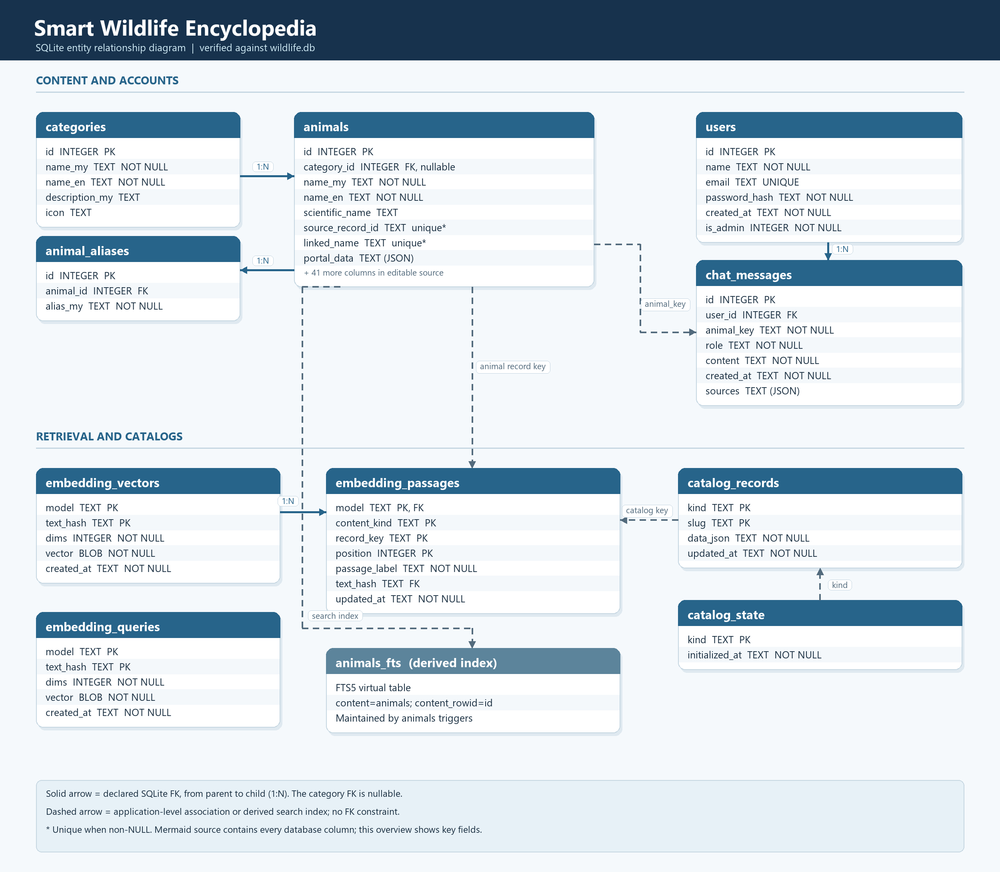

# Smart Wildlife Encyclopedia — ER diagram

This diagram was generated from the current `wildlife.db` schema. The PNG shows key columns for readability; [er_diagram.mmd](er_diagram.mmd) contains every column and can be edited or rendered with Mermaid.

In the PNG, solid arrows point from a parent row to its dependent rows and show declared SQLite foreign keys. Dashed arrows show application-level associations or the derived FTS search index; SQLite does not enforce them as foreign keys.

## Declared SQLite relationships

| Child column | Parent column | Child-side requirement |
| --- | --- | --- |
| `animals.category_id` | `categories.id` | Nullable; each animal has zero or one category |
| `animal_aliases.animal_id` | `animals.id` | Required; each alias belongs to one animal |
| `chat_messages.user_id` | `users.id` | Required; deleting a user cascades to messages |
| `embedding_passages.(model, text_hash)` | `embedding_vectors.(model, text_hash)` | Required composite FK; deleting a vector cascades to passages |

Each parent can have zero or many child rows. `embedding_queries` has no declared relationship to `embedding_vectors` despite sharing column names.

## Application-level associations

- `chat_messages.animal_key` looks up `COALESCE(animals.source_record_id, 'local-animal:' || animals.id)`. SQLite does not enforce this as a foreign key.
- `embedding_passages.(content_kind, record_key)` identifies an animal, ecosystem, or protected area in application code. Its target varies by `content_kind`, so there is no declared FK to `animals` or `catalog_records`.
- `catalog_state.kind` and `catalog_records.kind` use the same values but have no declared FK.
- `animals_fts` is a derived FTS5 search index of `animals`, maintained by triggers. It is not a separate business entity. Its FTS5 shadow tables are omitted.
- `animals.source_record_id` and `animals.linked_name` each have a partial unique index for non-NULL values. `users.email` has a unique constraint.

To regenerate after a schema change, run `python docs/generate_er_diagram.py` from the project directory. The script checks the declared FK set before writing either diagram file.
